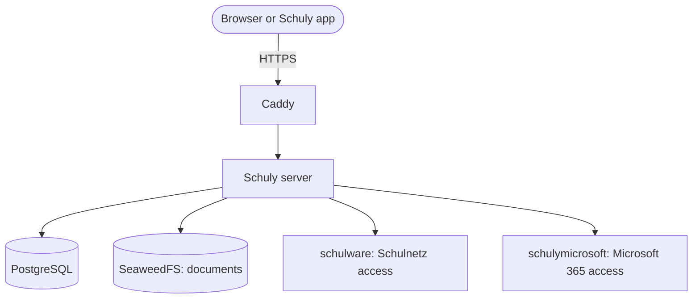

# Self-host Schuly

Run your own Schuly server with Docker. At the end, the Schuly app and web app use your server
with automatic HTTPS.

Testing on your home network, without a domain? Use [Run without a domain](self-hosting-lan.md).

## What you need

- A Linux server with Docker and the Docker Compose plugin
- Ports 80 and 443 open to the internet
- A domain name for the server, such as `api.schuly.example`
- An SMTP server, so Schuly can send verification and password-reset mails

## What runs on your server



Only Caddy is reachable from the internet. Schuly has its own sign-in, so you don't need a
separate identity provider.

## 1. Point your domain at the server

Create an A or AAAA record for your domain and wait until it resolves to your server. Caddy
can't get a certificate until it does.

## 2. Get the deploy files

```sh
git clone https://github.com/schulydev/SchulyServer.git
cd SchulyServer/deploy
cp .env.example .env
```

Run all commands on this page from the `deploy` folder.

## 3. Fill in `.env`

Replace every `change-me` value before the first start.

| Variable | Value |
|---|---|
| `API_HOST` | Your domain, such as `api.schuly.example` |
| `SCHULY_VERSION` | A fixed version from the [releases](https://github.com/schulydev/SchulyServer/releases), so you decide when to upgrade. `latest` follows every release. |
| `POSTGRES_USER`, `POSTGRES_PASSWORD` | A database user and a strong password |
| `LOCAL_LOGIN_SIGNING_KEY` | Output of `openssl rand -base64 32` |
| `TWO_FACTOR_ENCRYPTION_KEY` | Output of `openssl rand -base64 32` |
| `DOCUMENTS_ENCRYPTION_KEY` | Output of `openssl rand -base64 32` |
| `VAULT_MASTER_KEY` | Output of `openssl rand -base64 32` |
| `AVATAR_SIGNING_KEY` | Output of `openssl rand -hex 32` |
| `S3_ACCESS_KEY`, `S3_SECRET_KEY` | An access key and a strong secret |
| `SMTP_HOST`, `SMTP_PORT`, `SMTP_FROM`, `SMTP_USER`, `SMTP_PASSWORD` | Your mail server |

Then set the same S3 values in `config/seaweedfs/s3-config.json`. If they differ, document
storage fails.

::: warning Back up `.env` and keep the keys
Changing a key later has lasting effects:

- `LOCAL_LOGIN_SIGNING_KEY`: everyone is signed out.
- `TWO_FACTOR_ENCRYPTION_KEY`: two-factor stops working for every account.
- `DOCUMENTS_ENCRYPTION_KEY`: stored documents become unreadable.
- `VAULT_MASTER_KEY`: everyone must reconnect their school.
:::

## 4. Start Schuly

```sh
docker compose -f compose.staging.yml up -d
docker compose -f compose.staging.yml logs -f backend
```

On the first start, Schuly sets up its database and downloads its plugins, and Caddy gets a
certificate.

## 5. Check that it works

Open `https://<your domain>/api/app/school-systems`. You should see a list of school systems.

## 6. Create your account

Open `https://<your domain>` and register. Every account is equal and sees only its own data.
There is no admin role.

## 7. Connect the app

In the Schuly app, choose **Self-hosted** on the server screen and enter
`https://<your domain>` as the **Backend URL**.

## Optional features

| Feature | How to turn it on |
|---|---|
| Push notifications | Set `FIREBASE_SERVICE_ACCOUNT_JSON` in `.env`. See [Configuration](configuration.md#push-notifications-firebase). |
| Microsoft password sign-in in the web app | Set `MICROSOFT_SERVICE_KEY` in `.env` to the output of `openssl rand -hex 32`. |
| Single sign-on | See [Configuration](configuration.md#single-sign-on-oidc-providers). |
| Helply's code workspace | See the [deploy README](https://github.com/schulydev/SchulyServer/blob/main/deploy/README.md). |

To choose which school systems your server offers, see [Plugin management](../plugin-management.md).

## Next steps

- [Run and upgrade your server](operations.md)
- [All settings](configuration.md)
